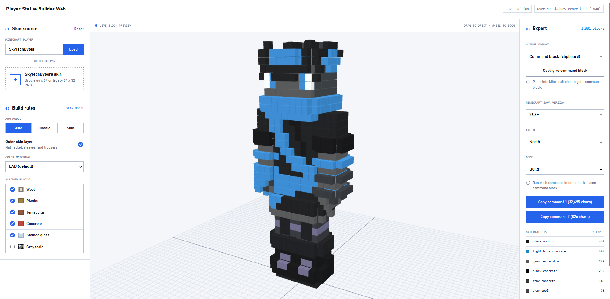
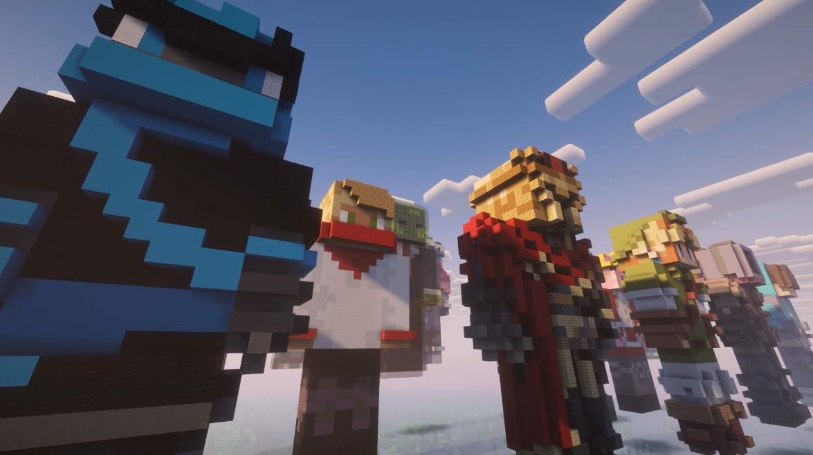

# Minecraft Player Statue Builder / Skin Statue Builder Web
SkyTechBytes' player statue builder as a web application-- converts all Minecraft skin formats into player/skin/block statues. Outputs vanilla commands to generate the statue WITHOUT MODS OR PLUGINS. Also supports exports to other formats (ex: litematica, 3D model).



## Usage
1) Navigate to the webpage
2) Enter your username or upload a skin image file under "Skin Source"
3) Choose settings and export format
4) To generate the statue in your world without mods, plugins, or a custom server, select command block as export
5) Select version and settings
6) `/give @p minecraft:command_block` and place in-game
7) For each command button shown:
    1) Copy the command and paste it in the SAME command block (replace any existing command)
    2) Run it
8) Optionally copy and run the undo command in the same command block to undo

## Export

Available outputs:

- Command block — choose Java version, facing, and Build/Undo mode. Commands are automatically split into parts of at most 32,500 characters, each with a copy button. Run them in order in the same retained command block. Undo clears the entire statue bounding box to air, not just previously placed blocks.
- `.litematic` — Litematica region with a packed block-state palette.
- `.schem` — Sponge Schematic v2 for WorldEdit-compatible tools.
- `.nbt` — vanilla Java Edition structure-block format.
- `.schematic` — legacy MCEdit/WorldEdit numeric block format.
- `.mcfunction` — readable relative `setblock` commands.
- `.glb` — binary glTF 2.0 model with mapped colors and glass alpha.
- `-compat.glb` — opaque RGB-only glTF for importers that reject vertex alpha or blended materials.
- `.ply` — colored voxel mesh with an RGBA vertex property.
- `-compat.ply` — RGB-only PLY for strict readers that reject the optional alpha property.
- `.csv` — XYZ, block-state, and color table.
- `.psb.json` — lossless canonical project document.

## Production and Maintenance

The application is based off of the Bukkit/Spigot/Paper plugin that I made of the same name, https://github.com/SkyTechBytes/PlayerStatueBuilder and aims to faithfully reproduce its behavior including transparency and color/block selection. I aim to keep the two in sync.

This port was created with the assistance of AI.

Please report any bugs or issues in the issues tab.

## Download telemetry

Telemetry about statue creations is sent when an export is downloaded.

## Serve locally

```bash
npm install
npm run dev
```

Open the URL printed by Vite, normally `http://localhost:5173/`.

Player-name lookup works on static hosting. Following upstream's `MineskinSkinFetcher`, the browser requests `https://mineskin.eu/download/{username}` directly and falls back to MCHeads' public name endpoint.

To deploy under a normal `public_html` directory, run `npm run build` and upload the contents of `dist/` to `public_html/`.

Production check and preview:

```bash
npm test
npm run build
npm run preview
```

